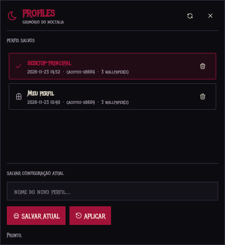

# Noctalia Plugins — Akimitsu76

Fonte de plugins para o [Noctalia](https://noctalia.dev). Este repositório abriga o
plugin de perfis góticos e todos os plugins futuros.

## ✦ Plugins disponíveis

| Plugin | ID | Descrição |
|---|---|---|
| Profiles | `victor/profiles` | Perfis completos de personalização do desktop (config, widgets, layout, molduras, fontes, cores, wallpaper e plugins) |



## ✦ Instalar como fonte

```bash
noctalia msg plugins source add akimitsu git https://github.com/Akimitsu76/noctalia-plugins
noctalia msg plugins update akimitsu
noctalia msg plugins enable victor/profiles
```

Para abrir o painel:

```bash
noctalia msg panel-toggle victor/profiles:profiles
```

### Atalho sugerido (niri)

```kdl
Mod+Shift+P { spawn-sh "noctalia msg panel-toggle victor/profiles:profiles"; }
```

## ✦ Atualizar

```bash
noctalia msg plugins update akimitsu
```

## ✦ Estrutura

Cada plugin vive num diretório cujo nome é a parte depois da `/` do id
(`victor/profiles` → `profiles/`). O `catalog.toml` na raiz indexa todos os plugins
para o Noctalia listar e verificar compatibilidade sem precisar clonar o repo.

```
.
├── catalog.toml          # índice de plugins
├── profiles/             # victor/profiles
│   ├── plugin.toml
│   ├── panel.luau
│   ├── service.luau
│   ├── frames.luau
│   ├── gothic-sticker.luau
│   ├── gothic-label.luau
│   └── translations/
├── bin/                  # utilitários usados pelo plugin
├── systemd/              # unidades user para automação das molduras
├── hooks/                # hook opcional do pacman
└── docs/panel.png
```

## ✦ Adicionar um plugin futuro

1. Crie o diretório com o nome do plugin e um `plugin.toml` válido.
2. Adicione a linha correspondente em `catalog.toml`.
3. Faça commit e push — quem usa a fonte recebe no próximo
   `noctalia msg plugins update akimitsu`.

## ✦ Licença

MIT — veja [LICENSE](LICENSE).
