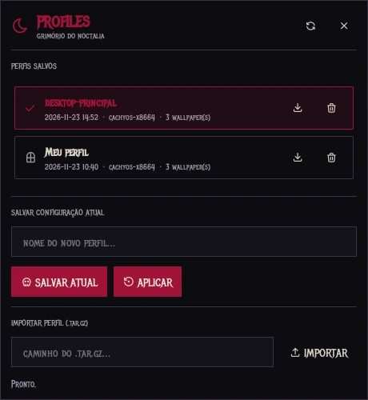

# Profiles — Grimório do Noctalia

Plugin de **perfis completos** para o [Noctalia](https://noctalia.dev). Salva e
reaplica **toda** a personalização do desktop — configuração da shell, widgets,
layout, molduras, fontes, cores, papel de parede e plugins — e agora permite
**exportar e importar** qualquer perfil como um arquivo `.tar.gz` portátil.



## O que é salvo

| Item | Origem |
|---|---|
| Config da shell, barra, fontes, cores | `~/.config/noctalia/` |
| Widgets, layout, molduras, wallpaper, tema | `~/.local/state/noctalia/settings.toml` |
| Dados de plugins | `~/.local/state/noctalia/plugins/data/` |
| Wallpapers referenciados | copiados para dentro do perfil |
| Metadados (data, host, versão) | `manifest.json` |

## Molduras góticas nativas

O plugin também desenha molduras **diretamente na UI**, sem PNG sobreposto,
para os widgets que ele controla:

- borda externa `#6b0f2a` (3 px) e interna `#8a1230` (2 px), cantos quadrados
- stickers com proporção livre — largura e altura ajustáveis separadamente
- label "Akimitsu76" com borda única
- aplicação automática a widgets novos via serviço `frames` + systemd path unit


## Uso

Abra o painel com **Mod+Shift+P** ou:

```sh
noctalia msg panel-toggle victor/profiles:profiles
```

| Ação | O que faz |
|---|---|
| **SALVAR ATUAL** | salva a config atual com o nome digitado |
| **APLICAR** | restaura o perfil selecionado |
| ícone de download na linha | exporta aquele perfil para `~/Documents/noctalia-profiles/` |
| **PROCURAR ARQUIVO** | abre o seletor de arquivos (zenity) para escolher o `.tar.gz` |
| **IMPORTAR** | lê um `.tar.gz`, instala o perfil, atualiza a lista e **aplica automaticamente** |

Se o `zenity` não estiver instalado, o campo de caminho continua funcionando.
Falhas do comando (arquivo inexistente, nome duplicado) agora aparecem em
vermelho no painel — não são mais anunciadas como "importado".

### Exportar / importar pela linha de comando

```sh
# exporta para o caminho padrão
noctalia-profile export desktop-principal

# exporta para um caminho específico
noctalia-profile export desktop-principal ~/Downloads/meu-tema.tar.gz

# importa (o nome vem do manifesto) e APLICA automaticamente
noctalia-profile import ~/Downloads/meu-tema.tar.gz

# importa com outro nome / sobrescreve
noctalia-profile import ~/Downloads/meu-tema.tar.gz meu-tema --force

# apenas instala o perfil, sem aplicar
noctalia-profile import ~/Downloads/meu-tema.tar.gz --no-apply
```

O pacote contém `manifest.json`, `config/`, `settings.toml`, `plugins-data/` e
`wallpapers/`. Caminhos de extração são validados e o arquivo é gerado de forma
atômica — nenhum caminho absoluto do seu usuário é embutido.

### IPC do service

```sh
noctalia msg plugin victor/profiles:service all "export desktop-principal"
noctalia msg plugin victor/profiles:service all "import ~/Downloads/meu-tema.tar.gz"
```

## Atalho sugerido (niri)

```kdl
Mod+Shift+P { spawn-sh "noctalia msg panel-toggle victor/profiles:profiles"; }
```

## Requisitos

- Noctalia com plugin API 46+
- `Pillow` (usado pelo gerador de molduras)

## Licença

MIT.
