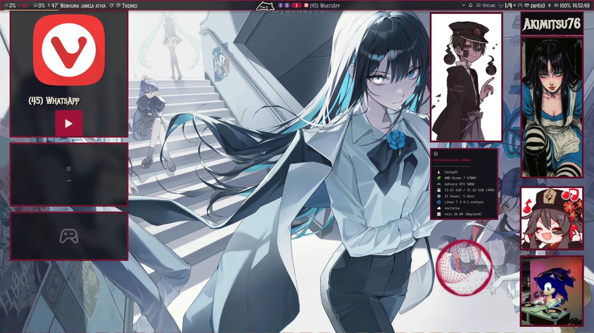

# Profiles — Grimório do Noctalia

Plugin de **perfis completos** para o [Noctalia](https://noctalia.dev). Salva e
reaplica **toda** a personalização do desktop e exporta isso como um `.tar.gz`
portátil. Ao importar em outro computador, o plugin **adiciona as fontes e
habilita os plugins que faltam**, **remapeia os monitores** (de `DP-3` para
`eDP-1`, por exemplo) e só então restaura a configuração — sem `install.sh`,
sem edição manual e sem depender de nada em `~/.local/bin`.


## Snapshot completo (schema v2)

| Item | Origem no perfil |
|---|---|
| `~/.config/noctalia/` **inteiro** | `config/` (config.toml, paletas, fontes, plugins locais/QML, assets) |
| `~/.local/state/noctalia/settings.toml` **inteiro** | `settings.toml` |
| `[plugins].enabled`, `[[plugins.source]]`, `[desktop_widgets]`, `[widget.*]`, `[plugin_settings.*]`, `[bar.*]`, `[theme]`, `[wallpaper]`, `[shell]` | dentro de `settings.toml` |
| Dados dos plugins | `plugins-data/` |
| Plugins locais (`kind = "path"`) | `local-plugins/<fonte>/` |
| Molduras geradas | `frames/` |
| Wallpapers, avatares, stickers, capas, fontes e qualquer asset referenciado por caminho absoluto | `assets/` + mapa no manifesto |
| Revisão (commit) de cada fonte git | `plugins.sources[].revision` |
| Outputs ativos no save (connector, descrição, fabricante, modelo, serial, resolução e primário) | `outputs[]` no manifesto (via `niri msg outputs`, `wlr-randr --json` ou `hyprctl monitors -j`) |
| Ordem e tipos dos widgets de área de trabalho | `desktop_widgets.widget_order`, `.widget_count`, `.widget_types[]` |
| Remapeamento aplicado no destino | `output_remap` no manifesto |
| Host, data, versão do Noctalia e checksums | `manifest.json` |

Nenhum caminho absoluto do seu usuário entra no pacote: caminhos dentro do
`HOME` são gravados como `~/...` e reexpandidos na máquina de destino.
O manifesto v1 (com `wallpapers` em vez de `assets`) continua sendo lido.

## O que acontece na máquina de destino

Antes de sobrescrever qualquer coisa, o CLI `noctalia-profile`:

1. lê o manifesto e descobre as fontes/plugins declarados;
2. adiciona cada fonte git/paths que não existe e roda `plugins update <fonte>`;
3. habilita cada plugin faltante e confirma que ele apareceu materializado
   (timeout de 30 s);
4. copia plugins `path` embarcados para
   `~/.local/share/noctalia/user-plugins/<fonte>` e reescreve o `location` no
   `settings.toml`;
5. detecta os outputs atuais, monta o `output_map` (o primário salvo vai para o
   primário atual; os demais são distribuídos na ordem; com um só monitor, todos
   são espelhados nele) e **reescreve uma cópia do `settings.toml`** antes de
   aplicar: `output` dos widgets, ids `@conector` do lockscreen, seções
   `[wallpaper.monitors.<nome>]`, `placement_width/height` e `cx/cy`
   escalados para a resolução atual;
6. restaura `config/`, `plugins-data/`, `frames/`, `local-plugins/`, assets e o
   `settings.toml` remapeado (backup timestampado e rollback em caso de falha);
7. roda `noctalia msg config-reload`, `noctalia msg desktop-widgets-show` e o
   gerador de molduras embarcado;
8. confere plugins habilitados, `widget_order`, outputs inválidos e existência
   dos assets, reportando diferenças em linhas `DIFF=`.

Nenhum widget fica apontando para um conector que não existe na máquina de
destino. O mapa usado fica registrado em `manifest.output_remap` para auditoria.

Saída machine-readable (usada pelo painel e pelo service):

```
PROFILE=desktop-principal
PHASE=instalando plugins 3/30: victor/profiles
PHASE=remapeando monitors
PHASE=restaurando widgets
PHASE=recarregando shell
OUTPUT_REMAP=DP-3->eDP-1
WIDGETS_RESTORED=14
APPLIED=1
PLUGINS_INSTALLED=source:akimitsu,victor/profiles,foo/bar
INSTALLED_PLUGINS=source:akimitsu,victor/profiles,foo/bar
MISSING_PLUGINS=
```

`INSTALLED_PLUGINS=` continua sendo emitido para compatibilidade com painéis
antigos; `PLUGINS_INSTALLED=` é o nome novo.

## Molduras góticas nativas

- borda externa `#6b0f2a` (3 px) e interna `#8a1230` (2 px), cantos quadrados
- stickers com proporção livre — largura e altura ajustáveis separadamente
- label "Akimitsu76" com borda única
- aplicação automática a widgets novos via serviço `frames` + systemd path unit

O gerador `noctalia-widget-frames` também vem embarcado em `profiles/bin/`.



## Uso

Abra o painel com **Mod+Shift+P** ou:

```sh
noctalia msg panel-toggle victor/profiles:profiles
```

| Ação | O que faz |
|---|---|
| **SALVAR ATUAL** | captura o snapshot completo com o nome digitado |
| **APLICAR** | instala o que faltar e restaura o perfil selecionado |
| ícone de download na linha | exporta aquele perfil para `~/Documents/noctalia-profiles/` |
| **PROCURAR ARQUIVO** | abre o seletor de arquivos (zenity) para escolher o `.tar.gz` |
| **IMPORTAR** | instala fontes/plugins, atualiza a lista e **aplica automaticamente** |

O painel mostra a fase atual e, no final, quantos widgets foram restaurados,
quantos plugins foram instalados, qual remapeamento de monitor ocorreu e o que
faltou. Erros trazem a causa concreta (fonte não adicionada, plugin que não
apareceu após `enable`, output inexistente, asset ausente etc.) — nunca apenas
"comando falhou".
Se o `zenity` não estiver instalado, o campo de caminho continua funcionando.

Tanto o painel quanto o service chamam os CLI que vêm dentro do plugin via
`noctalia.pluginDir()`:

- `python3 <pluginDir>/bin/noctalia-profile`
- `python3 <pluginDir>/bin/noctalia-widget-frames`

Eles acompanham o auto-update da fonte git. **Não é preciso rodar
`install.sh` nem instalar nada em `~/.local/bin` na máquina de destino.**

### Linha de comando

```sh
# snapshot do estado atual
noctalia-profile save desktop-principal

# exporta para o caminho padrão ou um caminho específico
noctalia-profile export desktop-principal
noctalia-profile export desktop-principal ~/Downloads/meu-tema.tar.gz

# importa e APLICA, instalando fontes/plugins que faltarem
noctalia-profile import ~/Downloads/meu-tema.tar.gz

# confirma automaticamente fontes git desconhecidas (o painel já faz isso)
noctalia-profile import ~/Downloads/meu-tema.tar.gz --yes

# importa com outro nome / sobrescreve / só instala
noctalia-profile import ~/Downloads/meu-tema.tar.gz meu-tema --force --yes
noctalia-profile import ~/Downloads/meu-tema.tar.gz --no-apply --yes

# simula sem alterar nada
noctalia-profile apply desktop-principal --dry-run
```

Flags disponíveis: `--yes` (confirma fontes git sem prompt), `--dry-run`
(não altera nada), `--force` (substitui perfil existente no import) e
`--no-apply` (apenas instala o perfil na lista).

Segurança: backup timestampado antes de qualquer substituição, validação do tar
(sem caminhos absolutos, `..`, symlinks escapando ou arquivos gigantes), limite
de 512 MB por pacote, escrita atômica do `settings.toml`, rollback em falha e
**nenhum script vindo do perfil é executado**.

### IPC do service

```sh
noctalia msg plugin victor/profiles:service all "export desktop-principal"
noctalia msg plugin victor/profiles:service all "import ~/Downloads/meu-tema.tar.gz"
```

## Atalho sugerido (niri)

```kdl
Mod+Shift+P { spawn-sh "noctalia msg panel-toggle victor/profiles:profiles"; }
```

## Requisitos

- Noctalia com plugin API 46+
- `python3` (CLI embarcados) e `Pillow` (gerador de molduras)
- `zenity` apenas para o botão **PROCURAR ARQUIVO**

## Testes

```sh
python3 -m unittest discover -s tests -v
```

Os testes simulam uma máquina B com `HOME`/XDG isolados e um falso `noctalia`,
verificando snapshot v2, reinstalação de fontes/plugins, assets, widget order,
tar malicioso e compatibilidade com manifest v1. Há ainda um teste que salva os
widgets em `DP-3` e aplica numa máquina com apenas `eDP-1`: confere que nenhum
widget/seção de wallpaper continua em `DP-3`, que `placement_*` e `cx/cy` foram
escalados, que a ordem dos widgets foi preservada e que `OUTPUT_REMAP` foi
emitido. Variável `NOCTALIA_PROFILE_OUTPUTS` (JSON) força os outputs detectados
para testes.

## Licença

MIT.
